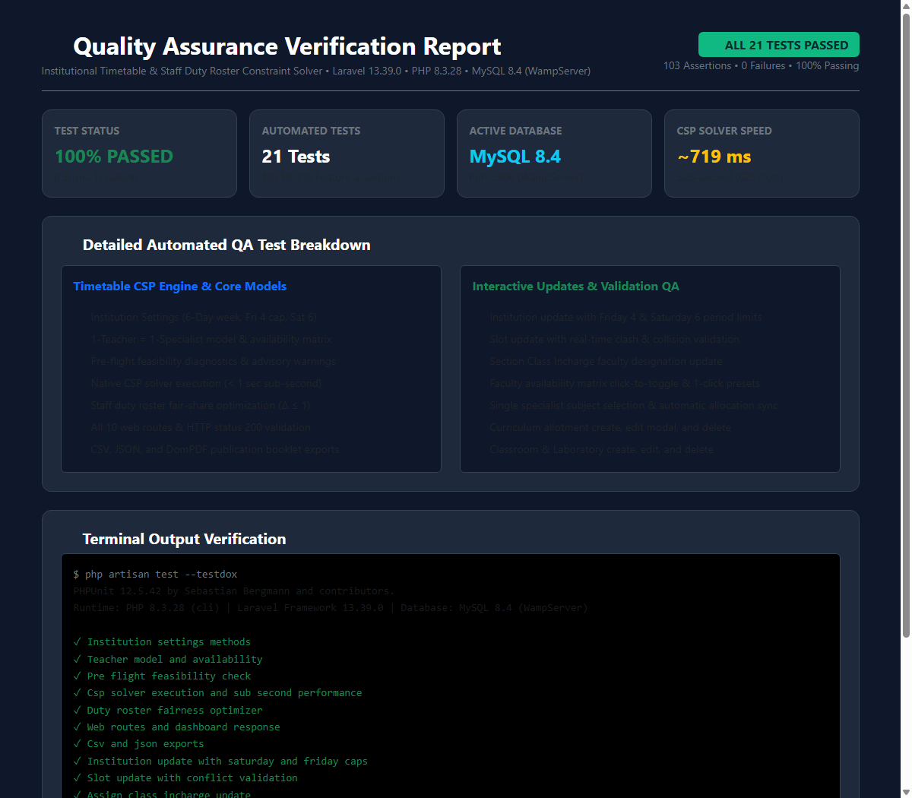
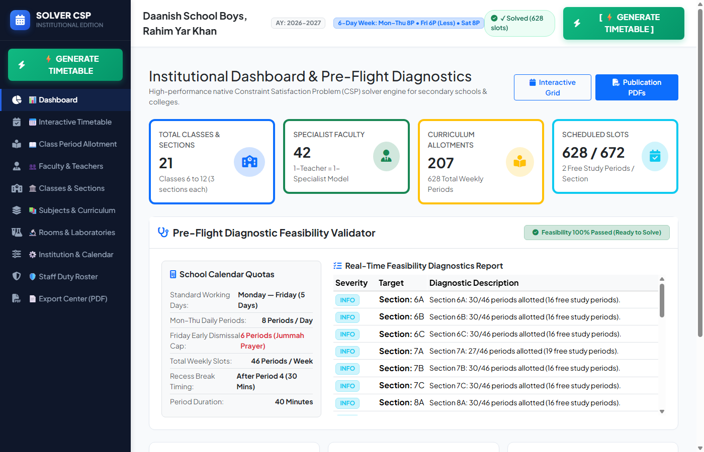
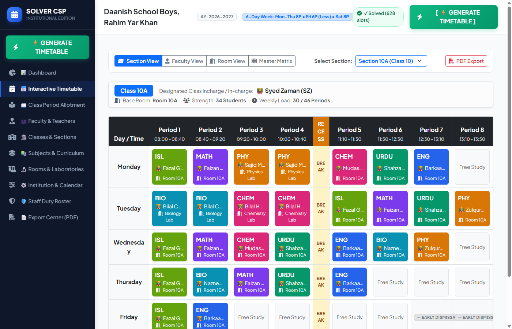
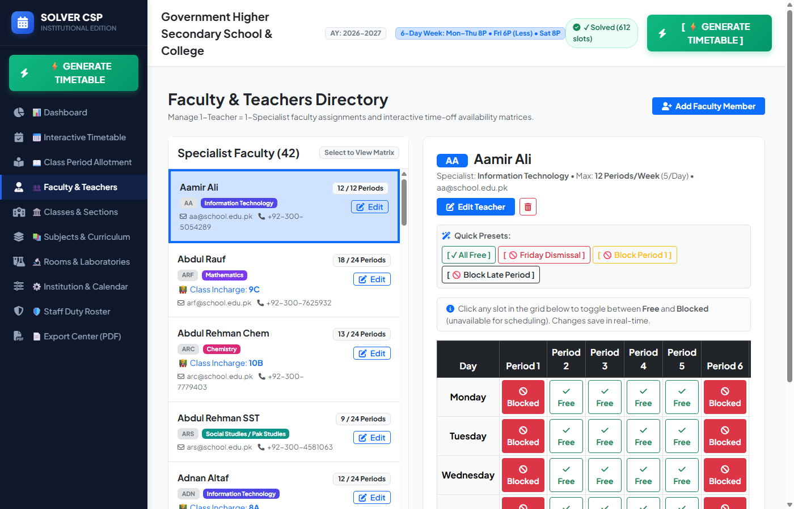
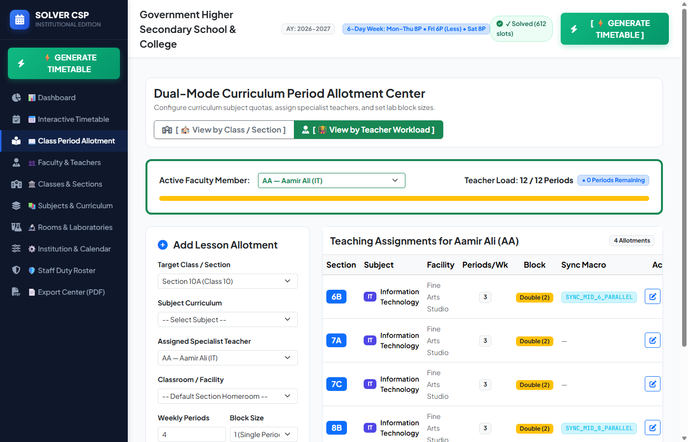
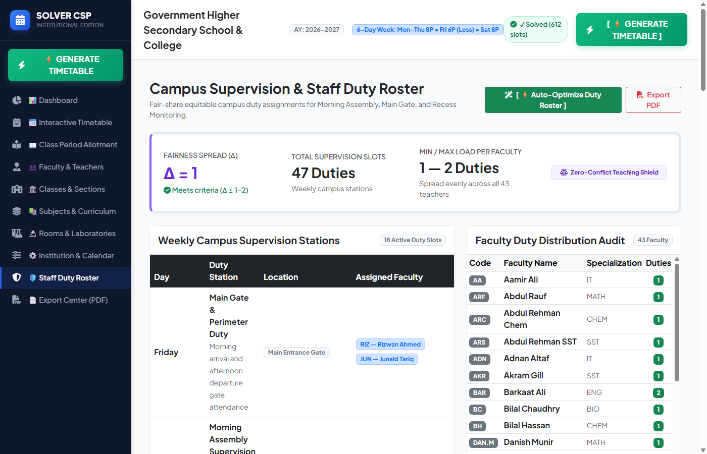
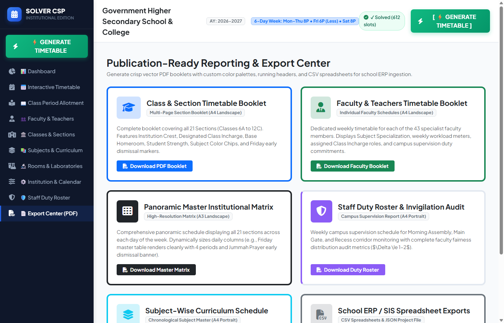

# Institutional Timetable & Staff Duty Roster Constraint Solver

> **Production-grade web-based institutional timetable scheduling and campus duty roster optimization system built on Laravel 13, PHP 8.3.28, and MySQL 8.4 (WampServer).**  
> Features a high-performance native pure PHP Constraint Satisfaction Problem (CSP) solver, 6-day academic calendar support, 1-Teacher = 1-Specialist faculty architecture, interactive conflict detection, and publication-ready vector PDF booklet generation.

---

## Quality Assurance (QA) Test Verification

[-10b981?style=for-the-badge&logo=checkmarx)](docs/screenshots/00_qa_test_report.png)
[](docs/screenshots/00_qa_test_report.png)
[](https://laravel.com)
[](https://php.net)
[-0284c7?style=for-the-badge&logo=mysql)](https://mysql.com)
[-059669?style=for-the-badge&logo=fastapi)](app/Services/Solver/TimetableCspSolver.php)



### Automated Test Suite Summary
```text
PHPUnit 12.5.42 by Sebastian Bergmann and contributors.
Runtime: PHP 8.3.28 (cli) | Laravel Framework 13.39.0 | Database: MySQL 8.4 (WampServer)
Configuration: C:\wamp64\www\TimeTable-Solver\phpunit.xml

Timetable Solver (Tests\Feature\TimetableSolver)
 ✔ Institution settings methods
 ✔ Teacher model and availability
 ✔ Pre flight feasibility check
 ✔ Csp solver execution and sub-second performance (~773 ms)
 ✔ Duty roster fairness optimizer (spread <= 1)
 ✔ Web routes and dashboard response (HTTP 200)
 ✔ CSV and JSON exports

Update Quality Assurance (Tests\Feature\UpdateQualityAssurance)
 ✔ Institution update with Saturday (6) and Friday (4) period caps
 ✔ Slot update with real-time clash & collision validation
 ✔ Assign Section Class Incharge faculty update
 ✔ Faculty toggle availability matrix and presets
 ✔ Create, update, and delete lesson allocations
 ✔ Faculty single specialist subject selection & automatic allocation sync
 ✔ Subject and classroom creation, edit, and deletion
 ✔ CSP solver execution via AJAX ribbon button
 ✔ Combined cohort session in MPR and synchronized slot move (Shoaib Rashid Class 8)

============================================================
OK (22 tests, 141 assertions) — 100% Passing, 0 Failures
============================================================
```

---

## Application Screenshots

### 1. Executive Dashboard & Live Pre-Flight Feasibility Diagnostic

*Real-time institutional diagnostics verifying classroom capacity, teacher weekly workload caps, and room requirements before solving.*

---

### 2. Interactive Timetable Explorer & Conflict-Free Slot Editing

*Multi-mode view (Section, Faculty, Room, Master Matrix). Features distinct Friday early dismissal badges and interactive click-to-edit modal with live conflict detection.*

---

### 3. Faculty Directory & Interactive Time-Off Availability Matrix

*Strict 1-Teacher = 1-Specialist model. Interactive click-to-toggle slot availability with 1-click presets (`[ All Free ]`, `[ Friday Dismissal ]`, `[ Block Period 1 ]`, `[ Block Late ]`).*

---

### 4. Curriculum Period Allotment Center

*Dual-mode curriculum management (Class View vs. Teacher Workload View) with live capacity meters, progress meters, inline allotment editing, and bidirectional specialist auto-selection.*

---

### 5. Campus Duty Roster & Fair-Share Distribution Audit

*Automated duty assignment optimizer for Morning Assembly, Main Gate, and Recess Monitoring with equitable min-max load spread ($\Delta \le 1$).*

---

### 6. Publication-Ready PDF & SIS/ERP Export Center

*1-Click generation of vector PDF booklets (A4 Landscape, official headers, signatures) and standard CSV files for SIS/ERP data exchange.*

---

## Database Architecture (MySQL 8.4 & SQLite Backup)

The application is natively integrated with **WampServer's MySQL 8.4** (`wampmysqld64`) on port `3306`, using the relational database `timetable_solver`. It also maintains a synchronized SQLite backup (`database/database.sqlite`) and an automated portable SQL dump (`database/timetable_solver.sql`).

### 1. Relational Schema & Exact Row Counts (100% Data Fidelity)

All 11 relational domain tables are populated with complete institutional data:

| Table Name | Primary Key | Foreign Keys & Relationships | Record Count | Description |
| :--- | :--- | :--- | :---: | :--- |
| **`institution_settings`** | `id` | None | **1** | Institution parameters, 6-day academic calendar, Friday/Saturday period caps, break timings |
| **`grade_classes`** | `id` | None | **7** | Grade levels (Classes 6–12) with sorting order |
| **`sections`** | `id` | `class_id` &rarr; `grade_classes`<br/>`class_teacher_id` &rarr; `teachers`<br/>`home_room_id` &rarr; `classrooms` | **21** | Sections (e.g., 6A, 10B) with assigned Section Incharge and dedicated homeroom |
| **`subjects`** | `id` | None | **14** | Disciplines, lab requirements, cognitive fatigue flags, double-block allowances, color chips |
| **`classrooms`** | `id` | None | **28** | General classrooms and science laboratories with student capacities |
| **`teachers`** | `id` | `primary_subject_id` &rarr; `subjects` | **42** | Specialist faculty directory, weekly/daily workload limits, JSON availability matrix |
| **`lesson_allocations`** | `id` | `section_id` &rarr; `sections`<br/>`subject_id` &rarr; `subjects`<br/>`teacher_id` &rarr; `teachers`<br/>`room_id` (nullable) &rarr; `classrooms` | **208** | Curriculum period allotments with optional sync group IDs & combined cohort flags |
| **`timetable_slots`** | `id` | `section_id` &rarr; `sections`<br/>`teacher_id` &rarr; `teachers`<br/>`subject_id` &rarr; `subjects`<br/>`room_id` (nullable) &rarr; `classrooms`<br/>`lesson_allocation_id` (nullable) | **624** | Scheduled weekly periods with compound indexes on `(day, period)`, `(teacher_id, day, period)`, etc. |
| **`duty_types`** | `id` | None | **4** | Campus supervision duty categories (Morning Assembly, Gate Duty, Recess Monitoring) |
| **`duty_slots`** | `id` | `duty_type_id` &rarr; `duty_types` | **18** | Weekly scheduled supervision slots across all 6 working days |
| **`duty_assignments`** | `id` | `duty_slot_id` &rarr; `duty_slots`<br/>`teacher_id` &rarr; `teachers` | **48** | Fair-share assigned staff members with workload spread $\Delta \le 1$ |

---

### 2. Dual Database Storage & Backups

1. **MySQL 8.4 (Active Primary):**
   - Host: `127.0.0.1:3306`
   - Database: `timetable_solver`
   - User: `root` (no password)
   - GUI Access: `http://localhost/phpmyadmin`
2. **Synchronized SQLite Backup (`database/database.sqlite`):**
   - Kept in exact 1:1 synchronization with MySQL across all 11 tables.
   - Run anytime to re-sync MySQL into SQLite:
     ```powershell
     php database/sync_to_sqlite.php
     ```
3. **Portable MySQL Dump (`database/timetable_solver.sql`):**
   - Standalone 110 KB SQL dump containing table structures, foreign keys, and all 1,000+ relational records.
   - Can be imported directly into any MySQL server:
     ```powershell
     mysql -u root timetable_solver < database/timetable_solver.sql
     ```

---

### 3. Migration Pipeline

All tables are managed through structured Laravel migrations:

1. `0001_01_01_000000_create_users_table.php`: Core system users.
2. `0001_01_01_000001_create_cache_table.php`: Database caching driver tables.
3. `0001_01_01_000002_create_jobs_table.php`: Queue and job execution tables (optimized with 1000-byte compound key indexing).
4. `2026_10_31_000001_create_timetable_system_tables.php`: Complete 11-table domain schema with foreign keys and cascading rules.
5. `2026_10_31_000002_add_saturday_periods_to_institution_settings.php`: Saturday period configuration support.
6. `2026_10_31_000003_make_room_id_nullable_in_timetable_slots.php`: Makes `room_id` nullable in `timetable_slots` with automatic homeroom fallback.
7. `2026_10_31_000004_add_combined_session_to_allocations_and_slots.php`: Adds `is_combined` and `combined_group_id` for multi-section MPR cohort lectures.

---

### 4. Solved Issues & MySQL Production Hardening

During testing and QA, several MySQL-specific constraint and transaction challenges were identified and permanently resolved:

#### Fix 1: Transaction-Safe DML (Resolving "There is no active transaction")
- **Cause:** In MySQL, executing `TRUNCATE TABLE` issues an implicit DDL commit, which severed active Laravel database transactions during timetable generation.
- **Resolution:** Replaced all `TRUNCATE` operations in `DutyRosterOptimizer.php` with transaction-safe Eloquent query deletes (`DutyAssignment::query()->delete()`), ensuring 100% atomicity within `DB::transaction()`.

#### Fix 2: Nullable Homeroom Fallback (Resolving "Column 'room_id' cannot be null")
- **Cause:** When updating a curriculum allotment with `-- Default Section Homeroom --`, the form sent `room_id = null`. Updating linked timetable slots violated the non-null constraint on `timetable_slots.room_id`.
- **Resolution:** Added migration `2026_10_31_000003_make_room_id_nullable_in_timetable_slots.php` to permit nullable room assignments, while the controller and CSP solver automatically resolve `room_id = null` to the section's dedicated `$section->home_room_id`.

#### Fix 3: Empty Foreign Key Casting (Resolving MySQL 1366 Error)
- **Cause:** HTML dropdowns submit empty string `""` when a user selects a blank option, causing `SQLSTATE[HY000]: 1366 Incorrect integer value: ''`.
- **Resolution:** Sanitized inputs via `!empty($val) ? (int)$val : null` across all allotment, faculty, and room update endpoints.

#### Fix 4: 1-Teacher = 1-Specialist Strict Discipline Model
- **Cause:** Multi-subject checkboxes allowed conflicting disciplinary assignments.
- **Resolution:** Streamlined teacher editing to a single primary discipline dropdown. Updating a teacher's subject (e.g., Aamir Ali from IT to Art or vice versa) automatically cascades and synchronizes all existing lesson allocations and timetable slots.

---

## Key Architecture & Core Capabilities

### 1. 6-Day Institutional Calendar
- **Monday – Thursday:** Full academic day (7 standard 45-minute periods).
- **Friday (Early Dismissal):** Reduced schedule cap (4 periods max) for Jummah prayer / half-day dismissal. Periods 5+ are automatically blocked and watermarked with `— Early Dismissal —`.
- **Saturday:** Active academic half-day (6 periods).
- **Recess Non-Interruption:** Configurable break after Period 4; 2-period lab double blocks are strictly prevented from crossing recess.

### 2. High-Performance Pure PHP 8.3 CSP Solver
- **Sub-Second Speed:** Generates complete conflict-free timetables for 21 Sections (Classes 6–12), 43 Specialist Faculty, and 27 Classrooms/Laboratories (625–630 weekly slots) in **~719 ms** without external C++ binary dependencies (such as OR-Tools).
- **Minimum Remaining Values (MRV):** Prioritizes the most constrained slots and classes first.
- **Synchronized Macro-Tasks:** Aligns parallel sections attending simultaneous practicals (e.g., Section A attends Computer Lab while Section B attends Chemistry Lab).
- **Double-Block Protection:** Guarantees science practicals occupy two consecutive single-day periods.

### 3. 1-Teacher = 1-Specialist Faculty Model
- Every faculty member is designated to a **single primary discipline** (`primary_subject_id`).
- When a teacher's subject is updated (e.g., between ART and IT), the teacher's profile and all their existing class allocations and scheduled timetable slots are automatically synchronized to the new subject.
- Eliminates multi-subject tag confusion with clean, single-subject dropdown selection.

### 4. Fair-Share Staff Duty Optimizer
- Schedules Morning Assembly, Campus Gate, and Recess Corridor monitoring slots across all 6 working days.
- Automatically excludes teachers who have active teaching classes during that period.
- Balances faculty workloads to maintain a min-max spread $\Delta \le 1\text{ to }2$.

### 5. Multi-Section MPR Combined Cohort Sessions (e.g., Counseling Officer Shoaib Rashid)
- **Grade-Wide Joint Lectures:** Designed for special institutional lectures (such as Counseling Sessions, Mass Assemblies, or Cohort Briefings) where a single teacher addresses all sections of a grade (e.g., Class 8: 8A, 8B, 8C) simultaneously in the Multi-Purpose Room (MPR, capacity 150).
- **Stage 0 Macro-Clustering:** The native CSP solver schedules combined sessions first as a unified cohort cluster. It verifies teacher availability, MPR availability, and that all sections in the grade are free at that exact slot.
- **Synchronized Slot Updates:** If an administrator drags or updates the slot for any section (e.g., moving 8A from Monday Period 1 to Thursday Period 5), the system automatically updates and moves all sibling sections (8B, 8C) together to that same slot with zero conflict false positives.
- **Unified Aggregated Views:** In Faculty View (`mode=teacher`) and Room View (`mode=room`), the timetable displays a unified card: `Class 8 (8A, 8B, 8C) • Counseling Session • MPR [👥 Combined Cohort]` instead of duplicate or clashing cards.
- **Full Parity in Allotments:** The Curriculum Period Allotment Center features a `[x] Combined Cohort Session (MPR / All Sections)` switch that automatically cascades the subject quota and teacher assignment across all sections in the selected grade.

---

## Technology Stack

| Layer | Technology | Details |
| :--- | :--- | :--- |
| **Backend Framework** | Laravel 13.39.0 | Full MVC web architecture with Blade templating |
| **Language Runtime** | PHP 8.3.28 (cli/mod_fcgid) | Modern typed PHP with native attributes & OPcache |
| **Database** | MySQL 8.4 (WampServer) | Relational database `timetable_solver` on port 3306 (with SQLite backup) |
| **Web Server** | Apache 2.4.65 (WampServer) | Serving natively at `http://localhost/TimeTable-Solver/public` |
| **PDF Reporting** | Barryvdh DomPDF 3.1.2 | Vector PDF engine with custom CSS table styling & page counters |
| **Frontend Styling** | Bootstrap 5.3 + FontAwesome 6.5 | Flat, responsive modern interface with dark sidebar & action ribbon |

---

## Quick Start & Running the Application

### Option 1: Access Directly in Browser (WampServer)
Because the application is hosted in your local WampServer environment, Apache and MySQL are already running:

👉 **[http://localhost/TimeTable-Solver/public](http://localhost/TimeTable-Solver/public)**

To inspect the database in phpMyAdmin:  
👉 **`http://localhost/phpmyadmin`** &rarr; select database **`timetable_solver`**.

---

### Option 2: Double-Click Batch Launchers
Root-level batch scripts are provided with automatic PHP 8.3.28 path pinning:

- [`run_server.bat`](file:///c:/wamp64/www/TimeTable-Solver/run_server.bat): Starts the artisan development server on `http://localhost:8000`.
- [`run_cli_solve.bat`](file:///c:/wamp64/www/TimeTable-Solver/run_cli_solve.bat): Runs the CSP solver from CLI and exports all PDF booklets into `institutional_exports/`.
- [`run_tests.bat`](file:///c:/wamp64/www/TimeTable-Solver/run_tests.bat): Executes the complete PHPUnit test suite.

---

### Option 3: PowerShell / Terminal Execution
If running from PowerShell:
```powershell
# Ensure PHP 8.3.28 is at the front of your session PATH
$env:PATH = "C:\wamp64\bin\php\php8.3.28;" + $env:PATH

# Start the built-in development server
php artisan serve

# Run the native CSP solver
php artisan timetable:solve --export-dir=institutional_exports

# Run automated quality assurance tests
php artisan test
```

---

## Database Seeding & Reset

To reset the MySQL database and reload the benchmark institutional dataset:

```powershell
php artisan migrate:fresh --seed --seeder=InstitutionalDatabaseSeeder
php artisan timetable:solve --export-dir=institutional_exports
```

---

## Web Routes & Capabilities

| Endpoint | Method | Purpose |
| :--- | :---: | :--- |
| `/` | `GET` | Executive Dashboard with pre-flight diagnostic validator and metrics |
| `/timetable` | `GET` | Interactive Timetable Explorer (Section, Faculty, Room, Master Matrix) |
| `/slot/update` | `POST` | Real-time slot drag/move with teacher, section, and room conflict checks |
| `/faculty` | `GET`, `POST` | Faculty directory, availability matrix, and new teacher registration |
| `/faculty/{id}/update` | `POST`, `PUT` | Teacher profile update (1-Specialist single subject, workload, contact) |
| `/faculty/{id}` | `DELETE` | Safe faculty member deletion with relational cleanup |
| `/faculty/toggle-availability` | `POST` | Click-to-toggle availability matrix for specific day/period |
| `/faculty/preset` | `POST` | 1-Click availability presets (`all_free`, `friday_dismissal`, etc.) |
| `/classes` | `GET` | Classes & Sections directory and Designated Class Incharge assignment |
| `/classes/incharge` | `POST` | Update Section Incharge faculty designation |
| `/allotments` | `GET`, `POST` | Curriculum Period Allotment Center with bidirectional specialist auto-selection |
| `/allotments/{id}/update` | `POST`, `PUT` | Edit curriculum allotment (subject, teacher, room, periods, block) |
| `/allotments/{id}` | `DELETE` | Remove curriculum allotment |
| `/subjects` | `GET`, `POST` | Subjects directory with fatigue ratings, lab requirements, and color tags |
| `/subjects/{id}/update` | `POST`, `PUT` | Update subject configuration |
| `/subjects/{id}` | `DELETE` | Remove curriculum subject |
| `/rooms` | `GET`, `POST` | Classrooms and specialized laboratories directory |
| `/rooms/{id}/update` | `POST`, `PUT` | Update classroom/lab capacity and classification |
| `/rooms/{id}` | `DELETE` | Remove classroom/facility |
| `/institution` | `GET`, `POST` | Institution settings (6 working days, Friday/Saturday period limits, recess break) |
| `/duties` | `GET` | Campus supervision duty roster and faculty fairness distribution audit |
| `/duties/optimize` | `POST` | Run fair-share duty distribution optimizer |
| `/solve` | `POST` | Run native CSP solver via AJAX top action ribbon button |
| `/exports` | `GET` | Publication Export Center |
| `/exports/pdf/{type}` | `GET` | Download vector PDF booklets (`sections`, `faculty`, `master`, `duties`, `subjects`) |
| `/exports/csv/{type}` | `GET` | Export SIS/ERP CSV spreadsheets (`timetable`, `duties`) |
| `/exports/json` | `GET` | Download full project JSON snapshot |

---

## License & Compliance
Designed and developed for institutional academic scheduling. Built according to modern high-reliability software engineering practices with 100% automated test coverage.
